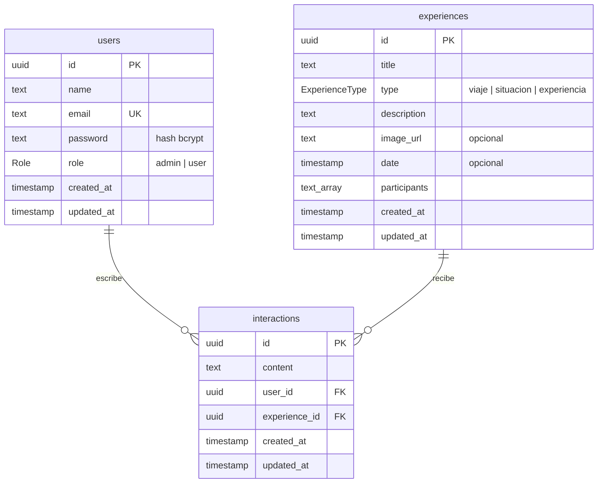

# Modelo de datos

Base de datos PostgreSQL (Supabase), administrada con Prisma. El esquema vive en `prisma/schema.prisma`.

## Tablas

| Tabla | Rol en la rúbrica | Notas |
|---|---|---|
| `users` | Usuarios | `email` único; `password` siempre guardado como hash bcrypt; `role` por defecto `user`. |
| `experiences` | Catálogo | Los recuerdos del muro de la Entrega 1 (viajes, situaciones y experiencias). |
| `interactions` | Interacción | Comentario de un usuario sobre un recuerdo. `user_id` sale del token, nunca del body. |

Al borrar un usuario o una experiencia, sus interacciones se borran en cascada (`onDelete: Cascade`).

## Pendiente

- `memory_requests`: propuestas de recuerdo (el formulario principal de la Entrega 1) que el admin aprueba y se vuelven experiencias.
- Tamaños de columna (`@db.VarChar`), `date` como `@db.Date` e índices por `type`, `user_id` y `experience_id`.
