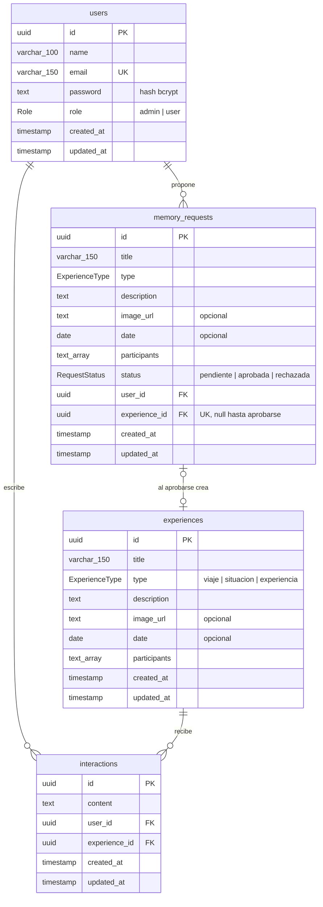

# Modelo de datos

Base de datos PostgreSQL (Supabase), administrada con Prisma. El esquema vive en `prisma/schema.prisma`.

## Tablas

| Tabla | Rol en la rúbrica | Notas |
|---|---|---|
| `users` | Usuarios | `email` único; `password` siempre guardado como hash bcrypt; `role` por defecto `user`. |
| `experiences` | Catálogo | Los recuerdos del muro de la Entrega 1 (viajes, situaciones y experiencias). |
| `interactions` | Interacción | Comentario de un usuario sobre un recuerdo. `user_id` sale del token, nunca del body. |
| `memory_requests` | Interacción | Propuesta de recuerdo (formulario principal del muro en la Entrega 1). El admin la aprueba y se crea la experiencia en una transacción. |

Al borrar un usuario o una experiencia, sus comentarios se borran en cascada. Al borrar un usuario se borran sus propuestas; al borrar la experiencia creada desde una propuesta, la propuesta se conserva con `experience_id` en `NULL`.

Índices: `experiences(type)`, `interactions(user_id)`, `interactions(experience_id)`, `memory_requests(user_id)` y `memory_requests(status)`.
